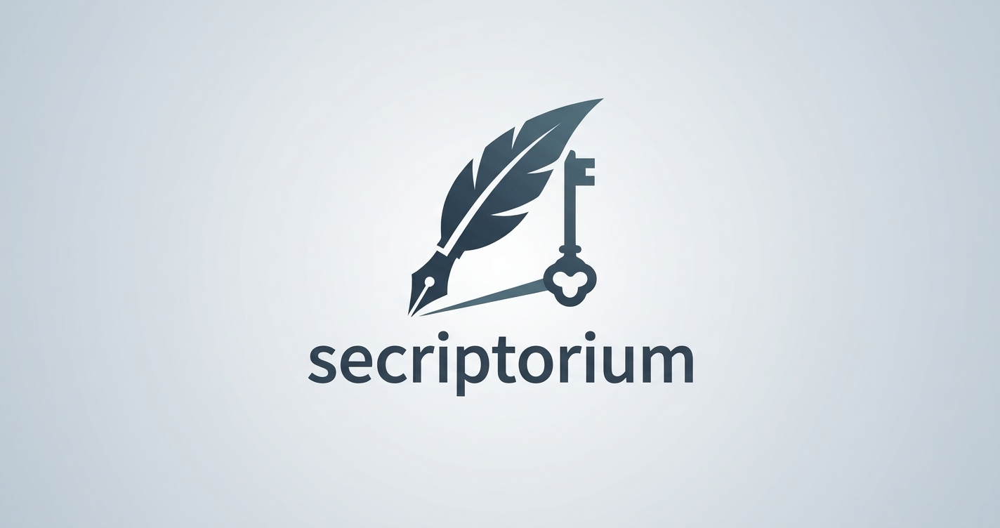

<p align="center">
  
</p>

# Secriptorium

**Static. Client-side. Nothing leaves your browser.**

[Live Demo](https://lex0xf0c.github.io/secriptorium/) | [https://lex0xf0c.github.io/secriptorium/](https://lex0xf0c.github.io/secriptorium/)

[日本語](#日本語) | [English](#english) | [License](#license--ライセンス)

---

## 日本語

脆弱性情報の公表・提出を支援する、ブラウザだけで動く小さなツールです。**アドバイザリ作成**（Markdown）、**CVSS v3.x の計算**、**SBOM / VEX の作成支援**（CycloneDX JSON）に対応しています。CSAF 2.0 の出力は、将来の改善構想です。

入力内容はこのブラウザの中だけで処理され、外部へ送信されません。サーバーもデータベースもありません。

### 現在できること

- アドバイザリの入力フォーム（タイトル、概要、影響を受ける製品、CWE、脅威、対策、回避策、連絡先など）
- CVSS v3.0 / v3.1 の基本スコアと深刻度を自動計算（ベクターの貼り付け、または項目ごとの説明つき選択式）
- Markdown 出力（自社サイトへの掲載用）
- CVSS v3.x のグラフィカルな計算機（シナリオ別のプリセットつき）
- コピー、およびファイルへの保存
- SBOM / VEX の作成支援：Excel からの貼り付け、PURL の自動生成、CycloneDX 1.6 の JSON を SBOM と VEX の別の文書で出力、1クリックのデモ、入力チェック

### 今後の予定

- アドバイザリモードへの CSAF 2.0（JSON）出力の追加（発行者名・発行者のURLの入力欄も、あわせて追加する）
- SBOM / VEX の拡充（ライセンス、ハッシュ、依存関係、取引先向けの説明文書など）
- 日英の表示切り替え、定型文、公開前チェックなど（別リポジトリ [lite-advisory-maker](https://github.com/Lex0xF0C/lite-advisory-maker) の機能の移植）

### 出力についての注意

**Markdown**

- Markdown 記法（`#`、`*`、`-`、`>`、`` ``` `` など）を入力すると、出力にそのまま反映されます。
- 管理番号・製品名・バージョンは表として出力されます。`|` は自動でエスケープされ、改行は空白になります。それ以外の記法は表の中でも有効です。
- タイトルは1行の項目です。改行は空白として扱われます。
- HTML タグは入力のまま出力され、表示は掲載先の Markdown レンダラに依存します。本ツールの画面上では、HTML として解釈されません。

**CVSS**

- CVSS 4.0 は、現在は使えません。将来 CSAF 2.0 の出力を付ける場合、CSAF 2.0 が 4.0 に対応していないためです（CSAF 2.1 で対応予定のため、対応後に検討します）。

**CSAF 2.0（将来の予定）**

- CSAF 2.0 の出力は、現在、アドバイザリモードにありません。付ける場合は、出力が規格に完全に適合しているかどうかを、**公式の検証ツール（Secvisogram など）で必ず確認してください。**

**SBOM / VEX（CycloneDX）**

- 出力は CycloneDX 1.6 の JSON です。規格に完全に適合しているかどうかは、**公式の検証ツールで必ず確認してください。**
- SBOM と VEX は、別々の文書です。VEX は、bom-link（`urn:cdx:<SBOMのシリアル番号>/1#<bom-ref>`）で、SBOM の部品を指します。
- PURL は、エコシステムと名前から自動生成します。パッケージ管理の部品以外は `generic` です。誤った識別子を出さないため、エコシステムを推測しません。maven は「groupId:artifactId」の形で入力します。
- バージョンなどの値を、補って埋めることはしません。空欄は空欄のまま出力され、チェックで知らせます。
- 依存関係は、製品から各部品への1段だけです。ライセンスとハッシュには、まだ対応していません。
- 貼り付けは、1回あたり20万文字・2000行までです（超えた分は読み取りません）。
- 部品の表は、Excel 用の TSV としてコピーでき、次回、そのまま貼り戻せます（JSON の読み込みは設けていません）。
- 「影響なし」などの VEX の判定は、製品の提供者が、自分の責任で行うものです。本ツールは、判定の正しさを確認しません。
- デモは架空の機器の例です。CVE の内容は例示であり、使う前に NVD などで確認してください。デモ由来の出力には、サンプルである旨の印が付きます。

**共通**

- **公開前に必ず、掲載先での表示結果、または検証ツールの結果を確認してください。**

### 免責

CVSS は FIRST.Org, Inc. が所有・管理する規格です（条件のもとで使用しています）。

本ツールは文書づくりの補助です。公開の可否、内容の正確性、CVSS 評価の妥当性は、利用者が判断してください。公開前に、社内（法務・広報など）の確認を受けることを推奨します。

### 開発とデプロイ

Vite + Vue 3 + TypeScript で作られています。ビルドと GitHub Pages への公開は、GitHub Actions が自動で行います（`.github/workflows/deploy.yml`）。

1. リポジトリの Settings → Pages で、Source を「GitHub Actions」にします。
2. `main` ブランチに push すると、自動でビルドと公開が行われます。
3. 公開 URL は、Actions の実行結果と、Settings → Pages に表示されます。

`vite.config.ts` の `base` は、リポジトリ名から自動で決まります。リポジトリ名を変えても、設定を直す必要はありません。

### ファイル構成

| パス | 役割 |
| --- | --- |
| `index.html` | 入口（CSP の設定を含む） |
| `src/main.ts` | アプリの起動 |
| `src/App.vue` | 全体の枠組みとモードの切り替え |
| `src/modes/AdvisoryMode.vue` | アドバイザリ作成モードの画面 |
| `src/modes/CvssCalculatorMode.vue` | CVSS v3.x 計算機モードの画面 |
| `src/modes/SbomMode.vue` | SBOM / VEX 作成モードの画面 |
| `src/components/OutputPanel.vue` | 出力パネル（タブ、コピー、保存）。モード間で共用 |
| `src/components/CvssPicker.vue` | CVSS の項目選択（説明つき）とスコア計算の画面部品 |
| `src/lib/cvss.ts` | CVSS v3.0 / v3.1 の計算と、項目の定義・説明文（Vue に依存しない） |
| `src/lib/advisory.ts` | フォームの型、Markdown と CSAF の生成（Vue に依存しない。CSAF の生成は、将来の出力用に残してある） |
| `src/lib/i18n-ja.ts` | アドバイザリモードの日本語の文言、定型文、CWE の例文 |
| `src/lib/sbom.ts` | SBOM / VEX の型、貼り付けの解析、PURL、CycloneDX の生成、チェック、デモ（Vue に依存しない） |
| `src/lib/output.ts` | 出力パネルに渡すデータの型 |
| `src/style.css` | 見た目（ダークモード対応） |

### セキュリティ方針

- ネットワーク通信なし（CSP で `connect-src 'none'`）
- `v-html` と `innerHTML` を使用しない
- 外部スクリプト・外部 CSS・CDN を使用しない
- 実行時の依存は Vue のみ

不具合や脆弱性を見つけた場合は、Issue でお知らせください。

---

## English

A small browser-only tool that helps you publish and submit vulnerability information. It supports **advisory writing** (Markdown), **CVSS v3.x calculation** and **SBOM / VEX authoring** (CycloneDX JSON). CSAF 2.0 output is a planned improvement.

Everything you enter is processed in your browser and is never sent anywhere. There is no server and no database.

### What it does today

- Advisory form (title, overview, affected products, CWE, threat, countermeasure, workaround, contact, etc.)
- Automatic CVSS v3.0 / v3.1 base score and severity (paste a vector, or pick each metric with explanations)
- Markdown output (for your website)
- Graphical CVSS v3.x calculator (with scenario presets)
- Copy and save to file
- SBOM / VEX authoring: paste from Excel, automatic PURL generation, CycloneDX 1.6 JSON output with SBOM and VEX as separate documents, one-click demo, input checks

### Planned

- CSAF 2.0 (JSON) output in advisory mode (together with input fields for the publisher name and URL)
- More SBOM / VEX features (licenses, hashes, dependency graph, customer-facing explanation document, etc.)
- Japanese/English UI, presets and pre-publication checks (porting features from [lite-advisory-maker](https://github.com/Lex0xF0C/lite-advisory-maker))

### Notes on output

**Markdown**

- Markdown syntax (`#`, `*`, `-`, `>`, `` ``` ``, etc.) typed into the form is passed through as-is.
- Advisory ID, product names and versions are output as a table. `|` is escaped automatically and line breaks become spaces; other syntax still takes effect inside table cells.
- The title is a single-line field; line breaks are converted to spaces.
- HTML tags are output as typed; how they are displayed depends on the Markdown renderer of your publishing site. This tool's own screen does not interpret them as HTML.

**CVSS**

- CVSS 4.0 is not available. If CSAF 2.0 output is added later, note that CSAF 2.0 does not support CVSS 4.0 (it is expected in CSAF 2.1; to be considered then).

**CSAF 2.0 (planned)**

- CSAF 2.0 output is not currently available in advisory mode. When it is added, **always validate the output with an official validator (e.g., Secvisogram)**.

**SBOM / VEX (CycloneDX)**

- The output is CycloneDX 1.6 JSON. **Always validate it with an official validator**; conformance is not guaranteed.
- SBOM and VEX are separate documents. The VEX points to SBOM components with a bom-link (`urn:cdx:<SBOM serial number>/1#<bom-ref>`).
- PURLs are generated from the ecosystem and the name. Anything not from a package manager is `generic`. The tool never guesses the ecosystem, to avoid emitting wrong identifiers. Enter Maven components as "groupId:artifactId".
- Missing values (such as a version) are never filled in; they stay empty and are flagged by the checks.
- Dependencies are recorded one level only (product to each component). Licenses and hashes are not supported yet.
- Pasted text is limited to 200,000 characters and 2,000 rows per paste (the rest is ignored).
- The component table can be copied as TSV for Excel and pasted back next time (there is no JSON import).
- VEX judgements such as "not affected" are made by the product supplier, at their own responsibility. The tool does not verify them.
- The demo is a fictional device. CVE details are examples; check them against NVD or similar before use. Output derived from the demo carries a sample marker.

**General**

- **Always check the rendered result on your publishing site, or the validator output, before publishing.**

### Disclaimer

CVSS is owned and managed by FIRST.Org, Inc., and is used under the condition.

This tool only helps you draft documents. Whether to publish, the accuracy of the content and the validity of the CVSS assessment are your responsibility. We recommend an internal review (legal, PR, etc.) before publication.

### Development and deployment

Built with Vite + Vue 3 + TypeScript. GitHub Actions builds the site and publishes it to GitHub Pages (`.github/workflows/deploy.yml`).

1. In Settings → Pages, set Source to "GitHub Actions".
2. Pushing to `main` builds and publishes the site automatically.
3. The published URL is shown in the Actions run and in Settings → Pages.

The `base` path in `vite.config.ts` is derived from the repository name, so renaming the repository requires no config change.

### Project layout

| Path | Role |
| --- | --- |
| `index.html` | Entry point (includes the CSP) |
| `src/main.ts` | App bootstrap |
| `src/App.vue` | App shell and mode switching |
| `src/modes/AdvisoryMode.vue` | Advisory mode screen |
| `src/modes/CvssCalculatorMode.vue` | CVSS v3.x calculator mode screen |
| `src/modes/SbomMode.vue` | SBOM / VEX mode screen |
| `src/components/OutputPanel.vue` | Output panel (tabs, copy, save), shared across modes |
| `src/components/CvssPicker.vue` | CVSS metric picker (with explanations) and score calculation UI |
| `src/lib/cvss.ts` | CVSS v3.0 / v3.1 calculation and metric definitions/explanations (no Vue dependency) |
| `src/lib/advisory.ts` | Form types, Markdown and CSAF generation (no Vue dependency; the CSAF code is kept for the planned output) |
| `src/lib/i18n-ja.ts` | Japanese UI text, presets and CWE sample text for advisory mode |
| `src/lib/sbom.ts` | SBOM / VEX types, paste parsing, PURL, CycloneDX generation, checks, demo (no Vue dependency) |
| `src/lib/output.ts` | Data type passed to the output panel |
| `src/style.css` | Styling (dark mode supported) |

### Security policy

- No network access (`connect-src 'none'` in the CSP)
- No `v-html`, no `innerHTML`
- No external scripts, stylesheets or CDNs
- Vue is the only runtime dependency

If you find a bug or a vulnerability, please open an issue.

---

## License / ライセンス

[MIT License](LICENSE) © 2026 Lex0xF0C

本ソフトウェアは MIT ライセンスのもとで提供されます。/ This software is released under the MIT License.
